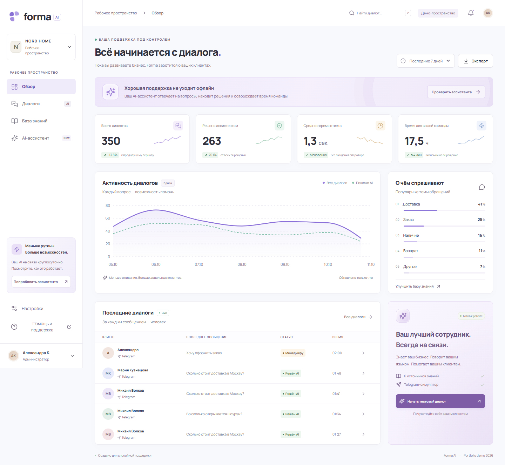

# Forma AI — AI Support Platform

Полноценный демонстрационный SaaS для портфолио: поддержка клиентов в Telegram, база знаний, RAG, аналитика и рабочее пространство администратора. Демонстрационный бренд — магазин предметов интерьера **NORD HOME**. Все клиенты, обращения и материалы вымышлены.



## Быстрый старт

### Windows: без Docker и API-ключей

Нужны Node.js 22+ и Python 3.11.

Откройте PowerShell в папке проекта:

```powershell
.\start-demo.ps1
```

Скрипт создаёт `.venv`, устанавливает зависимости, запускает FastAPI и Vite в фоне и открывает браузер. Если политика PowerShell запрещает локальные скрипты, используйте разовый запуск:

```powershell
powershell -ExecutionPolicy Bypass -File .\start-demo.ps1
```

- Приложение: http://127.0.0.1:5173
- Стартовая страница: http://127.0.0.1:5173/#welcome
- Telegram-симулятор: http://127.0.0.1:5173/#playground
- Swagger API: http://127.0.0.1:8000/docs
- Остановка процессов, запущенных скриптом: `./stop-demo.ps1`
- Логи: `.run/`. Локальная база: `backend/demo.db`.

### Docker Compose + PostgreSQL

```powershell
Copy-Item .env.example .env
docker compose up --build -d
```

Откройте http://localhost:8080. Compose запускает PostgreSQL 16, FastAPI и Nginx со статической сборкой React. Сервисы стартуют после health checks. Данные PostgreSQL сохраняются в именованном томе. Порт БД не публикуется; интерфейс привязан к loopback. Для внешнего доступа используйте HTTPS reverse proxy и отключите демо-режим.

```powershell
docker compose logs -f backend
docker compose down
```

Для запуска контейнеров нужен работающий Docker Engine. Команда `docker compose down` сохраняет данные PostgreSQL в именованном томе.

### Ручной запуск / macOS / Linux

```bash
python -m venv .venv
source .venv/bin/activate
pip install -r backend/requirements.txt
cd backend
uvicorn app.main:app --host 127.0.0.1 --port 8000
```

В другом терминале:

```bash
cd frontend
npm ci
npm run dev
```

На Windows вместо `source` можно использовать `.venv\Scripts\Activate.ps1`. Backend запускайте **из каталога `backend`**: `.env` читается из родительского каталога. Vite проксирует `/api` на `127.0.0.1:8000`, поэтому CORS и ключи в frontend не нужны.

## Что работает

| Раздел | Возможности |
| --- | --- |
| Обзор | Диалоги, решения AI, среднее время ответа, оценка сэкономленных часов, темы, график за 7/14/30 дней, CSV-экспорт, обновление каждые 30 секунд |
| База знаний | PDF до 10 МБ / 200 страниц, текст FAQ, одна публичная HTTPS-страница, поиск, удаление, статус готовности и число фрагментов |
| Диалоги | Поиск по имени и сообщениям, фильтры статуса, полная переписка, источники, время, закрытие командой |
| AI-ассистент | Интерактивный Telegram-симулятор, RAG-ответы, история, новый диалог, оформление заявки |
| Настройки | Компания, приветствие, тон, язык, включение передачи менеджеру, регистрация Telegram webhook |
| Стартовая страница | Самостоятельная маркетинговая страница, объяснение продукта и переходы в рабочее демо |

При первом запуске демо создаются 6 материалов и около 1 700 диалогов за 30 дней. Seed детерминированный, даты относительны моменту первого запуска. Повторный запуск не перезаписывает изменения. Отчёты группируются по московскому времени; часы сообщений отображаются в часовом поясе браузера.

Показатель «время для команды» — **оценка: 4 минуты × число решений AI**, а не измеренный рабочий трекинг. Закрытие диалога вручную имеет отдельный статус и не увеличивает число решений AI.

## AI и RAG

```text
PDF / FAQ / HTTPS-страница
        ↓ извлечение и очистка текста
Фрагменты по 850 символов, шаг 650 (перекрытие 200)
        ↓ разреженные частотные векторы
PostgreSQL JSON + таблицы документов и фрагментов
        ↓ TF-IDF cosine similarity, top-3, порог релевантности
Контекст + история последних 8 сообщений + настройки компании
        ↓
LLM Chat Completions API → ответ + источники
```

Без `LLM_API_KEY` включается **локальный лексический RAG**: реальное извлечение релевантных фрагментов и ответ из найденного материала. Это не генеративная модель и не семантический векторный поиск. Честное обозначение режима есть в интерфейсе. Для демонстрационного вопроса о доставке используется краткий ответ из стандартного материала. Если материал удалён, соответствующий ответ больше не выдаётся.

Для генеративных ответов скопируйте `.env.example` в `.env`:

```dotenv
LLM_API_KEY=your-key
LLM_BASE_URL=https://api.openai.com/v1
LLM_MODEL=gpt-4.1-mini
```

Можно подключить совместимый провайдер, поменяв URL и имя модели. Запрос идёт только с backend. При недоступности провайдера UI показывает ошибку и сохраняет введённый вопрос для повторной отправки. Модель получает указание отвечать только из контекста и не выполнять инструкции из документов. Отсутствие релевантного контекста приводит к предложению связаться с менеджером.

Локальный режим не переводит источники; полноценные ответы на выбранном языке работают с LLM. Тон в локальном режиме реализован упрощённо. Retrieval модуль изолирован в `backend/app/rag.py` и может быть заменён на semantic embeddings + pgvector без смены интерфейса.

## Telegram

1. Создайте бота через BotFather.
2. Запишите в `.env`:

```dotenv
TELEGRAM_BOT_TOKEN=token-from-botfather
TELEGRAM_WEBHOOK_SECRET=random-secret-with-letters-digits-underscores
TELEGRAM_MANAGER_CHAT_ID=123456789
PUBLIC_BASE_URL=https://your-public-domain.example
```

3. Менеджер должен предварительно начать диалог с ботом либо добавить его в нужную группу.
4. Направьте внешний HTTPS reverse proxy на frontend (`localhost:8080` в Compose). Он проксирует `/api` в backend.
5. Перезапустите backend. Откройте «Настройки → Подключить Telegram».

Сервер проверит `getMe` и зарегистрирует webhook через `setWebhook`. Входящие запросы проверяются по заголовку `X-Telegram-Bot-Api-Secret-Token`. Повторные `update_id` не создают повторных заявок. Токен не передаётся браузеру.

В реальном Telegram оформление заказа сохраняет заявку в таблицу `leads` и пытается отправить менеджеру сообщение. Фраза «Менеджер получил уведомление» возвращается только после успешного ответа Telegram API. Если отправка не удалась, заявка остаётся со статусом `failed`, а клиенту сообщается, что менеджер свяжется в рабочее время. Ответ Telegram API означает принятие сообщения сервисом, а не прочтение менеджером.

В **симуляторе** выполняется сценарий:

> Клиент: Сколько стоит доставка?
>
> AI: Стоимость доставки зависит от города. Москва от 500 рублей.
>
> Клиент: Хочу оформить заказ
>
> AI: Создал заявку. Менеджер получил уведомление.

Тестовая заявка сохраняется, но внешние уведомления не отправляются. Это явно отмечено рядом с чатом. Реальный Telegram и внешний LLM требуют собственных ключей; без них проверены локальный режим и mock-интеграция Telegram.

## Архитектура

```text
ai-support-platform/
├── frontend/
│   ├── src/main.tsx       # приложение, обзор, лендинг
│   ├── src/pages.tsx      # знания, история, симулятор, настройки
│   ├── src/api.ts         # типы и API-клиент
│   ├── src/styles.css     # дизайн, адаптивность, состояния
│   ├── tests/            # Playwright: полный пользовательский путь
│   ├── Dockerfile
│   └── nginx.conf
├── backend/
│   ├── app/main.py       # HTTP API, импорт, AI и Telegram
│   ├── app/db.py         # SQLAlchemy модели
│   ├── app/rag.py        # разбиение и поиск
│   ├── app/seed.py       # реалистичные демонстрационные данные
│   ├── app/config.py     # переменные окружения
│   └── tests/test_api.py
├── demo/company-knowledge.txt
├── docs/                 # дизайн, сценарий показа, результаты проверок
├── docker-compose.yml
├── .env.example
├── start-demo.ps1
└── stop-demo.ps1
```

Стек: React 19, TypeScript, Tailwind CSS 4 с собственными CSS-компонентами, Vite, Recharts, Lucide, Python FastAPI, SQLAlchemy 2, PostgreSQL 16, HTTP Telegram Bot API. Для локального показа SQLite использует те же ORM-модели. Manrope загружается через Google Fonts; при отсутствии сети используется системный sans-serif.

## Проверки

```bash
cd backend
python -m pytest -q
```

Тесты проверяют расчёты аналитики, доставка с источниками, сохранение заявки, добавление/удаление знаний, отказ от выдуманного ответа, PDF, защита импортера от локальных адресов, доступ администратора, webhook, дедупликация и ошибка LLM.

При запущенном frontend и backend, с установленным Google Chrome:

```bash
cd frontend
npm run build
npm run test:e2e
```

Playwright проверяет полный пользовательский путь, CSV, сохранение настроек после reload, мобильные экраны, навигацию и отсутствие ошибок JavaScript. Это тесты локального демо, они добавляют тестовый диалог и удаляют созданный ими FAQ. Не запускайте их против рабочей клиентской базы.

## Границы демонстрационного продукта

- Один workspace, без биллинга, регистрации, OAuth и многопользовательского RBAC. `DEMO_MODE=true` намеренно даёт доступ к демо без логина. Вне loopback отключите демо, задайте `ADMIN_API_KEY` длиной не менее 24 символов и используйте HTTPS. В UI ключ хранится только в `sessionStorage` текущей вкладки; это базовая защита демо, не замена полноценной авторизации.
- Настоящий production требует миграций, фоновой очереди индексации, лимитов запросов, резервных копий, мониторинга, ограничений по tenant и outbox/retry обработки Telegram. Таблица `telegram_updates` сохраняет `failed` для ручной сверки; автоматического повторения неудачных доставок нет. Один worker указан намеренно.
- PDF обрабатываются синхронно; сканы без текстового слоя требуют OCR, который не включён. Импорт сайта обрабатывает одну HTML-страницу, не выполняет JavaScript и не следует redirect. Текст ограничен 200 000 символов.
- Защита URL: только HTTPS/443, запрет локальных и служебных адресов, проверка DNS, закрепление IP при соединении с сохранением Host/TLS SNI, лимит 2 МБ. В локальном VPN Fake-IP режиме `198.18.0.0/15` применяется публичное DNS-over-HTTPS разрешение через `dns.google`; реальный адрес повторно проверяется. Имена запрошенных сайтов в этом режиме передаются DNS-провайдеру.
- RAG на разреженных словарях сканирует корпус в памяти и рассчитан на портфолио/небольшую базу. Для больших объёмов нужен отдельный поисковый индекс.

## Источники интеграций

- [FastAPI: загрузка файлов](https://fastapi.tiangolo.com/tutorial/request-files/)
- [Telegram Bot API](https://core.telegram.org/bots/api)
- [Telegram: работа webhook](https://core.telegram.org/bots/webhooks)

Сценарий демонстрации: [docs/demo-walkthrough.md](docs/demo-walkthrough.md).

## Видео для портфолио

В минутном ролике показаны аналитика, база знаний и путь от вопроса в Telegram-симуляторе до заявки. [Версия с озвучкой](videos/forma-demo/forma-ai-demo-jori-1080p.mp4) · [версия с музыкой и титрами](videos/forma-demo/forma-ai-demo-1080p.mp4) · [обложка](videos/forma-demo/cover.png).
